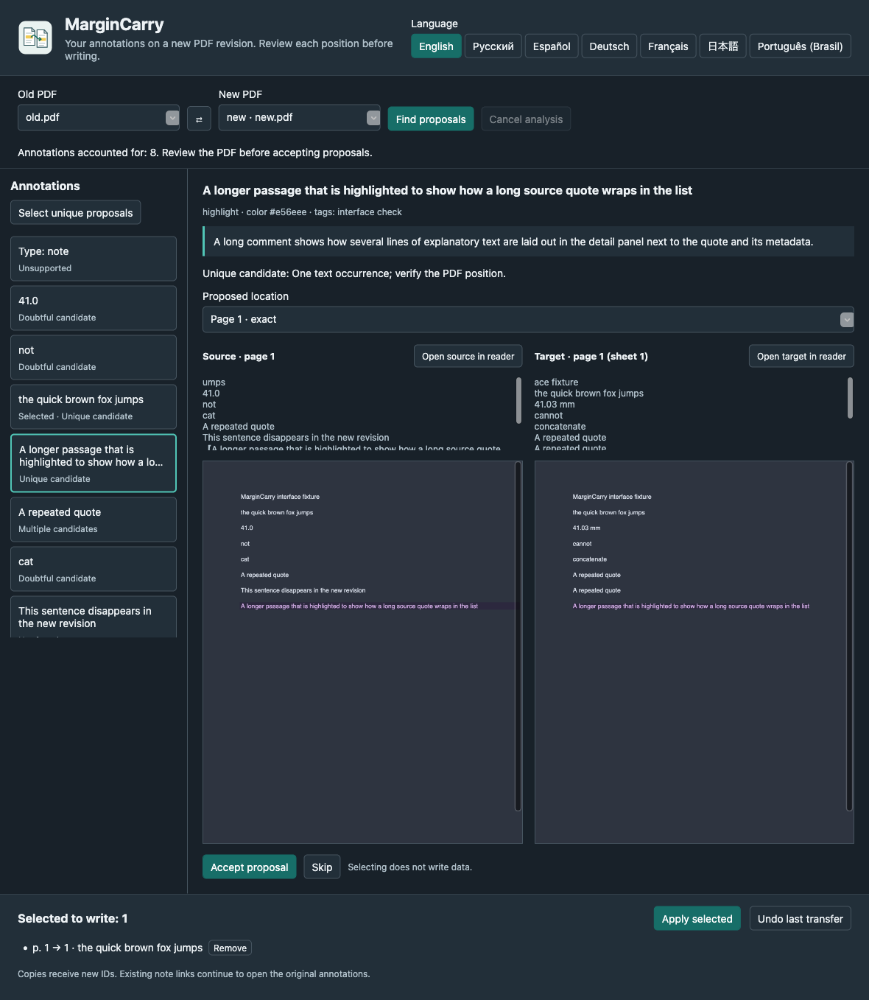
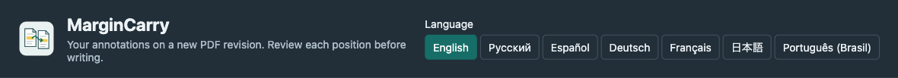
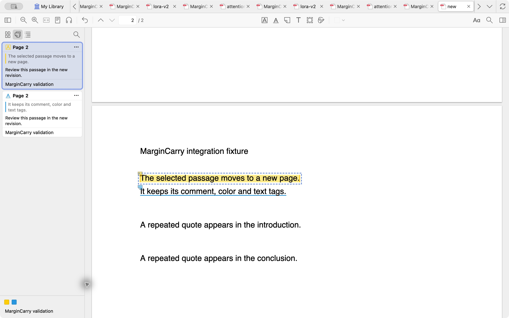

# MarginCarry

MarginCarry is a Zotero plugin that carries your highlights and underlines from one PDF revision to the next. When a paper gets a second version, you compare each original passage with its proposed new location, choose what to keep, and confirm the write. The result is an ordinary Zotero annotation that keeps its comment, color, and tags.

Nothing is written until you confirm. Your original annotations and PDF files are never changed, and every transfer can be undone.

## Features

- Transfers native highlights and underlines between two PDF attachments of the same Zotero item.
- Shows the original and the proposed location on the actual PDF pages, and opens either in the Zotero reader.
- Matches text exactly: only Unicode normalization and whitespace differences are tolerated, so a changed number or a negated sentence is never moved silently.
- Flags quotes that survive only inside a different word or number, such as `cat` in `concatenate` or `41.0` in `41.03`, and keeps them out of bulk selection.
- Records every transfer in a local journal, blocks accidental repeats, and undoes a transfer in one step.
- Works entirely offline on your computer. There is no account, server, or telemetry.
- Available in English, Russian, Spanish, German, French, Japanese, and Brazilian Portuguese.

## Requirements

- Zotero **10.0.5 or a later 10.0.x release** on desktop.
- Two PDF attachments of the same bibliographic item in your personal library, both available locally.
- A text layer in the new PDF. Scanned PDFs without text are reported as such; there is no OCR.

MarginCarry has been tested on macOS only. Windows and Linux have not been verified. See [Validation](docs/validation.md) for exactly what has been checked.

## Install

1. Download `margincarry-0.1.2.xpi` and its SHA-256 file from the [latest release](https://github.com/0then0/margincarry/releases/latest), or build it yourself (see [Development](docs/development.md)).
2. In Zotero, open **Tools → Plugins**, click the gear menu, choose **Install Plugin From File…**, and select the XPI.
3. Restart Zotero if asked. **MarginCarry: transfer PDF annotations…** now appears in the **Tools** menu.

The menu and the window follow Zotero's language. Other languages fall back to English, and the window has language buttons for switching at any time.

## Transfer annotations

1. Add the new PDF revision to the same item as the old one, then select both attachments (or the item).
2. Open **Tools → MarginCarry: transfer PDF annotations…**. Check **Old PDF** and **New PDF**; the swap button reverses the direction.
3. Click **Find proposals**. Every annotation of the old PDF gets an outcome. You can cancel at any time before writing.
4. Select an annotation in the list and compare the two previews, the quoted text, and the surrounding context. Use the reader buttons to look at either location in context.
5. Click **Accept proposal** to add it to the set, or **Skip**. When a quote has several possible locations you must choose one yourself.
6. **Select unique proposals** accepts every proposal that has exactly one well-founded location. Review the set it builds before you continue.
7. Check the list under **Selected to write**, click **Apply selected**, and confirm. MarginCarry creates new annotations in the new PDF.
8. **Undo last transfer** moves only that transfer's copies to the Zotero Trash. The copies also disappear from an open reader. [Screenshot after Undo](docs/images/undo.png).

Copies receive new annotation keys. Existing links in Zotero notes keep opening the original annotations.

## Understanding the outcomes

- **Unique candidate**: the quote was found once, or one occurrence matches the complete available context. Look at the preview before accepting.
- **Multiple candidates**: the quote occurs several times and the context does not decide. Nothing is preselected; choose the right occurrence. Changing your choice cancels the earlier acceptance. [Example](docs/images/ambiguous.png).
- **Doubtful candidate**: the quote exists only as part of a longer word or number, or inside a different word than in the old PDF. It is listed with a warning, never recommended, and skipped by **Select unique proposals**. You can still select it by hand after checking the preview.
- **Not found**: the quote no longer exists. If a number changed from `41.0` to `41.2`, the highlight is not moved onto the new number. [Example](docs/images/not-found.png).
- **Unsupported**: another annotation type, a selection that spans pages or is not continuous, or text that does not agree with its position.
- **Processing error**: the text was found but the PDF page data does not allow a reliable position, or extraction failed.

[How matching works](docs/how-it-works.md) describes the rules in detail, including word and number boundaries and what is deliberately not guessed.

## Privacy and data

Documents, previews, and annotations are processed locally. MarginCarry does not contact any server; Zotero's own network features, such as sync and plugin update checks, follow your Zotero settings.

The plugin stores one file, `margincarry/transfers.json`, in Zotero's data directory. It lists the keys of source and copied annotations, quotes, comments, positions, file paths and hashes, and fingerprints that make Undo and repeat protection possible. It can contain private text, so treat it like the rest of your library. Deleting it removes the undo history and the duplicate-transfer protection.

## Limitations

- Only native highlights and underlines that continue on one page are transferred. Ink, image, note, and multi-page annotations are not.
- Only personal libraries, and only two attachments of one item. There is no group-library, EPUB, or library-wide support.
- Matching is exact. There is no fuzzy matching, no translation, and no OCR. A rewritten sentence is reported as not found rather than guessed.
- The plugin uses internal Zotero reader APIs, so a future Zotero release can require an update. The manifest accepts Zotero 10.0.x only.
- Very large pages may not preview; open the location in the reader instead.
- Always review the proposed location. A text match is evidence, not proof, that a passage is the same one.

## Documentation

- [How matching works](docs/how-it-works.md)
- [Validation and known limits](docs/validation.md)
- [Architecture](docs/architecture.md)
- [Development guide](docs/development.md)
- [Related work](docs/related-work.md)
- [Changelog](CHANGELOG.md)

## Contributing

Bug reports, translation fixes, and pull requests are welcome. Read [CONTRIBUTING.md](CONTRIBUTING.md) first, follow the [Code of Conduct](CODE_OF_CONDUCT.md), and report security issues as described in [SECURITY.md](SECURITY.md).

## License

MarginCarry is released under the [Apache License 2.0](LICENSE). Third-party material is listed in [THIRD_PARTY.md](THIRD_PARTY.md).
